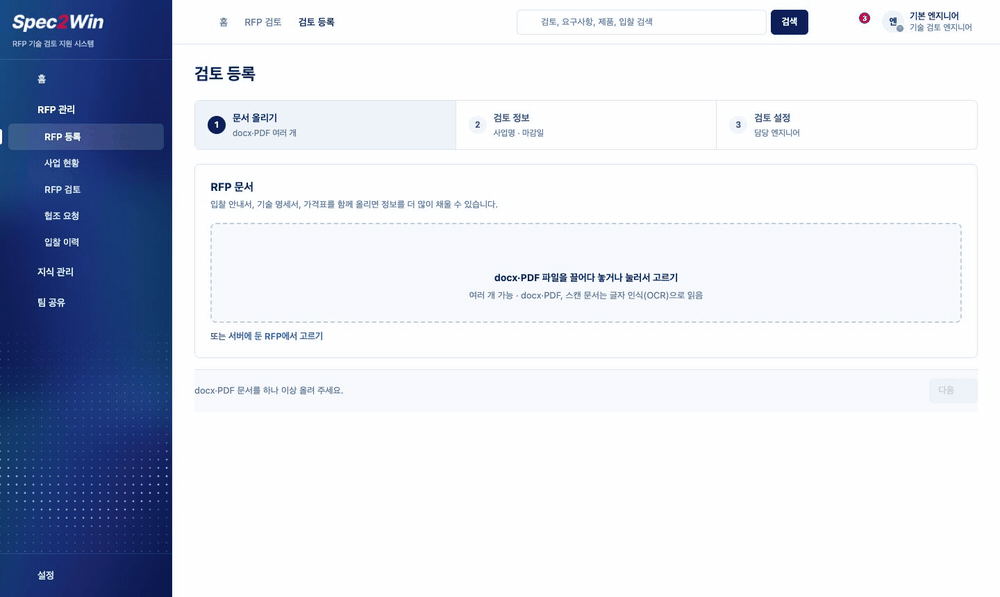
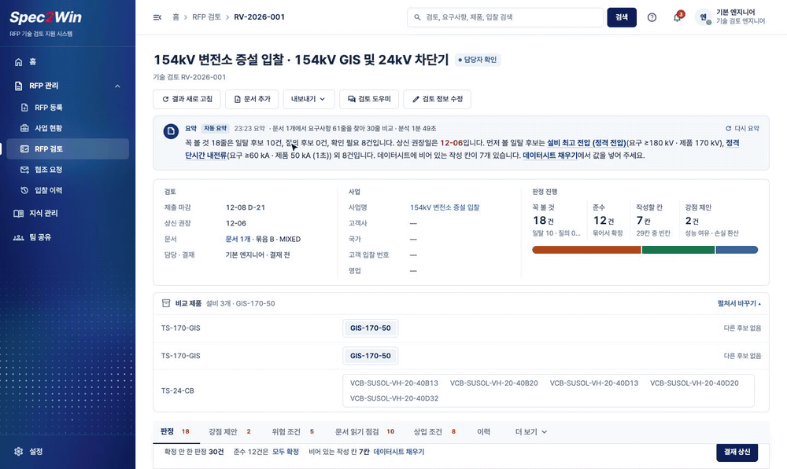
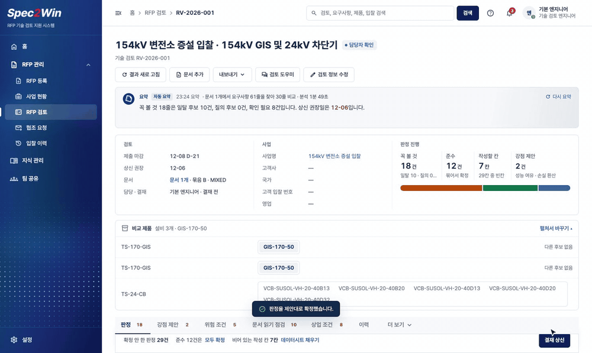
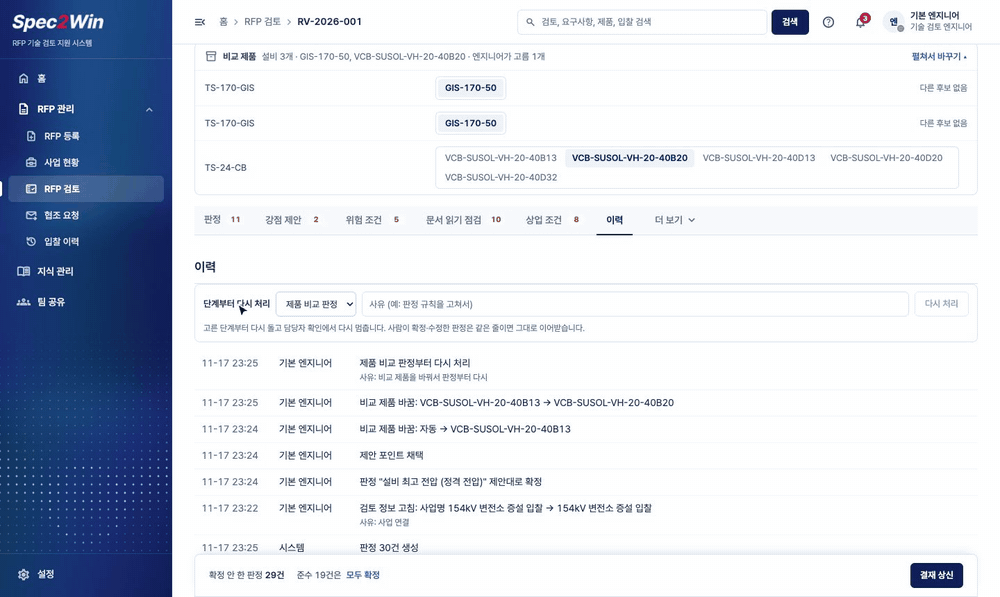
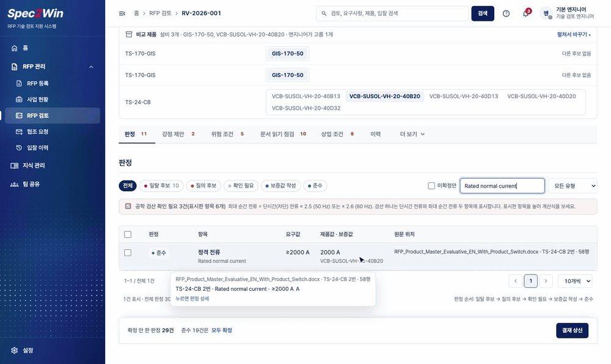
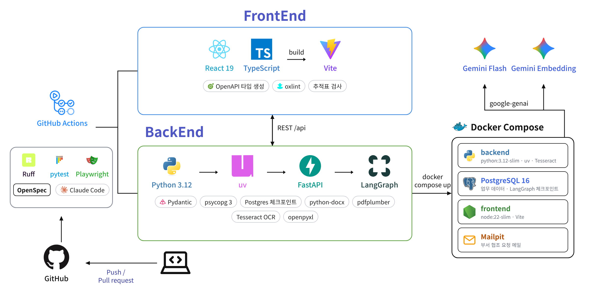
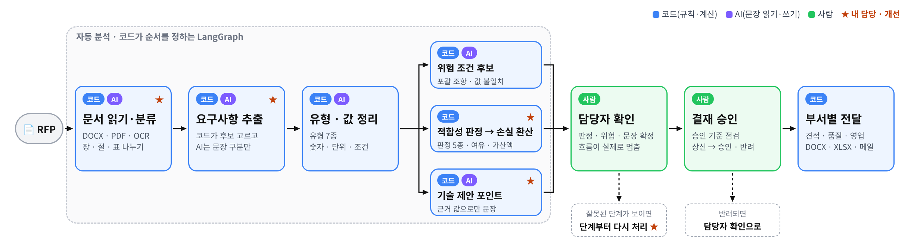
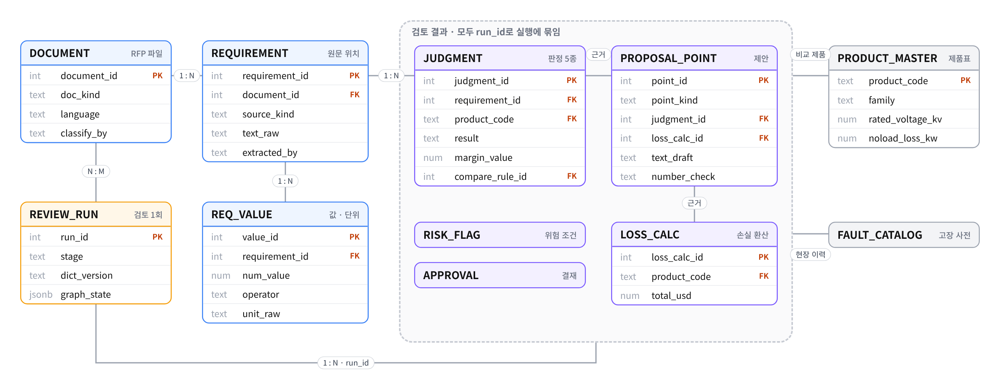

# Spec2Win · RFP 기술 검토 지원 AI

수백 쪽짜리 전력 설비 입찰 제안요청서(RFP)를 읽고 **지킬 조건은 빠짐없이, 내세울 강점은 근거와 함께** 찾아 주는 기술 검토 AI Agent입니다.
RFP의 요구값을 자사 제품값과 비교해 판정하고, 손실 환산과 기술 제안 포인트까지 만든 뒤, 엔지니어 확인과 결재를 거쳐 견적·품질·영업 담당에게 넘깁니다.
**LS ELECTRIC 기업 연계 프로젝트**로, LS ITC가 교육용으로 제공한 전력 설비 RFP 22개와 LS ELECTRIC 카탈로그 기반 제품표(122행)를 사용했습니다.
SKKU × LS AI CAMPUS 1기 2조의 팀 프로젝트(주제 2, 최종 발표작)를 개인 저장소로 옮겨 정리했습니다.


> 원본 팀 저장소: [skkuls-final-team/rfp-agent-service](https://github.com/skkuls-final-team/rfp-agent-service) · 팀원 4명 · 2026.10.23 ~ 2026.11.10 (11.10 최종 발표)

<table>
  <tr>
    <td width="50%" valign="top">
      <a href="docs/assets/readme/rfp-1-analyze.gif"></a>
      <p><b>① 검토 등록 · 자동 분석</b></p>
      <ul>
        <li>DOCX·PDF·스캔 문서를 읽어 장·절·표로 나누고, 요구사항과 원문 위치를 뽑습니다.</li>
        <li>요구사항 후보는 <b>코드가 고르고</b>, AI는 문장 구분과 유형 보조만 합니다.</li>
      </ul>
    </td>
    <td width="50%" valign="top">
      <a href="docs/assets/readme/rfp-2-judge.gif"></a>
      <p><b>② 적합성 판정</b></p>
      <ul>
        <li>요구값과 제품값을 규칙으로 비교해 <b>판정 5종</b>(준수·일탈 후보·질의 후보·확인 필요·보증값 작성)으로 나눕니다.</li>
        <li>판정마다 비교 규칙, 비교한 제품 행, 여유값, 원문 위치를 함께 보여 줍니다.</li>
      </ul>
    </td>
  </tr>
  <tr>
    <td width="50%" valign="top">
      <a href="docs/assets/readme/rfp-3-propose.gif"></a>
      <p><b>③ 강점 제안 · 비교 제품 바꿔 보기</b></p>
      <ul>
        <li>요구보다 여유가 있는 값과 현장 고장 이력에서 <b>강점 제안</b>을 뽑고, 근거 원문 위치를 붙입니다.</li>
        <li>비교할 제품을 다른 후보로 바꾸면 판정을 다시 계산합니다(예: 1,250 A 제품 → 일탈 후보, 2,000 A 제품 → 준수).</li>
      </ul>
    </td>
    <td width="50%" valign="top">
      <a href="docs/assets/readme/rfp-4-approve.gif"></a>
      <p><b>④ 담당자 확인 · 결재 · 부서 전달</b></p>
      <ul>
        <li>흐름은 담당자 확인과 결재 단계에서 <b>실제로 멈추고</b>, 사람이 확정해야 다음으로 넘어갑니다.</li>
        <li>승인된 결과만 견적·품질·영업 담당에게 문서(DOCX·XLSX)와 메일로 전달합니다.</li>
      </ul>
    </td>
  </tr>
</table>

## 내 역할 — 나송주 · 판정과 내세우기 + 문서 처리·흐름 제어·추출 정확도

팀은 역할을 **기능 단위**로 나눴습니다. 저는 RFP의 요구값을 제품과 비교해 판정하고 내세울 강점을 찾는 **판정과 내세우기**(FR-07·13·14·15)를 맡았고, 11월부터는 팀이 C1(문서 처리기)·C2(흐름 제어)로 나눈 고도화 작업과 추출 정확도·성능 개선을 맡았습니다.

| 구분 | 맡은 일 | 내용 | 코드 · PR |
| --- | --- | --- | --- |
| 판정과 내세우기 | 적합성 판정 | 요구값과 제품값을 비교 규칙으로 견줘 판정 5종으로 나누고, 여유값과 원문 위치를 붙임 | `pipeline/judge.py` · FR-07 |
| 판정과 내세우기 | 손실 환산 · 제안 포인트 · 현장 이력 | 손실값을 입찰 평가 금액으로 환산하고, 여유·손실 우위·현장 고장 이력에서 근거가 붙은 제안 포인트를 만듦 | `pipeline/loss.py`, `pipeline/proposals.py`, `pipeline/field_history.py` · FR-13·14·15 |
| 문서 처리 (C1) | 문서 종류별 추출 규칙 | 공급사 답안·입찰 서식·물량표(BOQ) 등 문서 종류마다 요구사항 후보를 고르는 규칙과 처리 뒤 점검 기준을 둠 | `pipeline/processors.py`, `pipeline/extract.py` · #104 #108 |
| 문서 처리 (C1) | 점검에 걸린 부분만 다시 묻기 | 처리 뒤 점검에서 떨어진 부분만 AI에 다시 물어 전체 재처리 비용을 줄임 | `pipeline/document.py` · #101 |
| 흐름 제어 (C2) | 흐름 기록 · 단계부터 다시 처리 | LangGraph 체크포인트로 단계별 기록을 보여 주고, 담당자가 고른 단계부터 다시 처리(사람이 확정한 결과는 이어받음) | `pipeline/graph_flow.py`, `pipeline/run.py`, `pipeline/doc_add.py` · #106 #110 |
| 문서 입력 | PDF · OCR | PDF 단락·선 없는 답안 표, 도면이 든 PDF, 스캔 문서와 그림 속 글자 읽기, 원문 위치에 쪽 번호 | `pipeline/pdf_reader.py`, `pipeline/ocr.py` · #118 #120 #176~#179 |
| 정확도 | 의무 표현이 없는 요구 줄 추출 | 놓친 줄을 분석해 원인이 AI가 아니라 "shall이 없는 요구 줄"임을 찾고 코드 규칙으로 보완 | `pipeline/extract.py` · #150 |
| 정확도 | 시연용 합성 RFP와 정답지 | 위험 조항·비교 제품 바꿔 보기용 합성 RFP와 요구사항·유형 정답지를 만들어 지표를 잴 수 있게 함 | `generate_*_rfp.py`, `data/seed/answer_keys/` · #128 #134 #138 |
| 성능 | 판정 값 읽기 색인 | 값마다 표 전체를 훑던 질의에 색인을 더해 큰 검토의 비교 제품 칸 응답을 **17.1초 → 0.87초**로 줄임 | `db/migrations/0035_value_indexes.sql` · #113 |
| 운영 | 시연 준비 · AI 사용량 기록 | 빈 DB에 시연 데이터를 한 번에 준비하는 `rfp-db demo-setup`, 분석 밖 AI 호출까지 사용량·비용 기록 | `db/cli.py`, `pipeline/ai_usage.py` · #153 #156 #162 |
| 화면 | 검토 화면 개선 | 판정 상세 검산 계산, 인계 패키지 미리 보기, 검토 목록 진행 막대·요약 거르기, 화면 문구를 업무 용어로 | `frontend/src/views/` · #130 #159 #163 #164 #172 |

<p align="center"></p>
<p align="center"><sub>단계부터 다시 처리 (C2) — 비교 제품을 바꾼 뒤 판정 단계부터 다시 돌리고, 사유와 함께 이력에 남깁니다.</sub></p>

> 팀은 OpenSpec 기반 개발(스펙 → 계획 PR → 구현 PR → archive)을 했고, change 하나를 PR 하나로 올렸습니다.

## AI 활용과 직접 판단·검증한 영역

이 프로젝트는 **AI 코딩 도구(Claude Code)로 구현하고, 사람은 스펙·설계 결정·검증을 맡는 방식**으로 만들었습니다.

| 단계 | AI가 한 일 | 내가 판단·검증한 일 |
| --- | --- | --- |
| 스펙 | OpenSpec 제안서·작업 목록 초안 작성 | 문서 종류마다 무엇을 요구사항으로 볼지, "단계부터 다시" 할 때 사람이 확정한 결과를 이어받을지 같은 범위·정책 결정 |
| 설계 | 기존 코드 탐색, 구현 방법 후보 제시 | 요구사항 후보 고르기·숫자·판정은 코드, AI는 문장 구분만 맡긴다는 원칙을 지키는지 확인 |
| 구현 | 코드와 시험 코드 작성 | 스펙의 시나리오마다 시험을 두고, 실제 RFP와 합성 RFP로 결과를 직접 확인 |
| 측정 | 지표 계산 스크립트 작성 | 정답지를 누가 정했는지(사람·코드·Claude 초안) 구분해 기록하고, Claude 초안 정답은 수치를 해석할 때 따로 표시 |
| 문제 해결 | 원인 분석과 수정안 작성 | 재현율이 낮은 원인이 **AI가 아니라 "shall이 없는 요구 줄"**임을 놓친 18줄을 직접 보고 찾음. 모델 측정 중 보고된 "Docker로 띄우면 AI 설정이 백엔드에 전달되지 않는" 문제도 원인을 찾아 고침(#141) |

AI가 낸 코드는 그대로 받지 않고, 시험과 실제 실행 결과로 확인한 것만 커밋했습니다.

## 아키텍처

<p align="center"></p>

| 기술적 결정 | 근거 |
| --- | --- |
| **숫자·판정은 코드, 문장 읽기·쓰기는 AI, 확정은 사람** | 판정 5종과 손실 환산은 규칙과 계산으로 재현돼야 함. AI를 꺼도 판정 건수와 숫자가 같도록 만들었고, AI는 정해진 9곳에서만 씀 |
| LangGraph로 **순서를 고정한 그래프**, 체크포인트는 PostgreSQL에 | 단계 순서와 분기는 코드 표가 정하고, 담당자 확인·결재에서 `interrupt`로 실제로 멈춤. 체크포인트가 있어 "단계부터 다시 처리"가 가능 |
| 요구사항 후보는 **코드가 고르고 AI는 빼기만** | AI가 요구사항을 새로 만들어 내지 못하게 함. 놓친 줄은 AI 프롬프트가 아니라 코드 규칙으로 보완 |
| 숫자는 **자리표시자로 두고 코드가 채움** | 일탈·질의 문장과 제안 문장에서 AI가 숫자를 지어내지 못하게 하고, 채운 뒤 숫자 대조로 다시 검사 |
| 모든 결과에 **원문 위치**(문서·절·표·쪽) | 엔지니어가 판정을 원문과 바로 맞춰 볼 수 있어야 확정할 수 있음 |

## 처리 흐름

RFP 한 건을 올리면 코드가 정한 순서대로 분석하고, 담당자 확인과 결재에서 멈춥니다.

<p align="center"></p>

**LangGraph를 쓴 이유**는 자율 에이전트가 필요해서가 아니라, **사람이 확인할 지점에서 흐름을 실제로 멈추고, 잘못된 단계가 보이면 그 단계부터 다시 처리**하기 위해서였습니다. 단계의 순서와 분기는 코드의 `NEXT` 표가 정합니다.

## 데이터 모델

DB는 번호순 SQL 마이그레이션 41개로 관리하고, 표는 원문(문서·절·표·요구사항), 기준 데이터(제품표·규칙 사전·고장 사전), 검토 결과(판정·위험·손실·제안·결재)로 나뉩니다. 설계에서 정한 원칙은 세 가지입니다.

- **결과는 검토 실행 단위**: 판정·위험 조건·손실 환산·제안·결재는 모두 `run_id`로 한 번의 검토에 묶입니다. 같은 RFP를 다시 검토해도 이전 결과가 섞이지 않습니다.
- **근거를 칸으로 강제**: 제안 포인트는 종류(여유·손실·현장 이력)에 맞는 근거 칸(판정·손실 환산·고장 연결)이 비면 DB 제약으로 저장되지 않습니다.
- **팀 가정 표시**: 공개 자료가 없어 팀이 정한 값(손실값 등)은 `is_assumed`로 표시하고 화면에 "팀 가정"으로 보여 줍니다.

<p align="center"></p>

## 성능과 개선 기록

교육용 합성 RFP와 LS 측 제공 RFP로 잰 값입니다. 정답을 누가 정했는지(사람·코드·Claude 초안)를 함께 적었습니다.

**내가 한 개선**

| 개선 | 지표 (정답을 정한 이) | 전 → 후 |
| --- | --- | --- |
| shall 없는 요구 줄을 코드 규칙으로 추출 (#150) | 요구사항 재현율, 합성 RFP 28 · AI 끔 (Claude 초안) | **72.3% → 100%** |
| AI 문장 구분 보완 · shall 없는 줄 추출 · 유형 규칙 (#147 #150 #158) | 요구사항 재현율, 합성 RFP 28 · AI 켬 (Claude 초안, 1회 측정) | **63.1% → 93.8%** |
| 공급사 답안 처리기 규칙 (#108) | 요구사항 재현율, 정답 200줄 (코드: 공급사 표시 줄) | **66.5% → 100%** |
| 판정 값 읽기 색인 (#113) | 비교 제품 칸 응답 시간, 값 4,929개 검토 | **17.1초 → 0.87초** |

**팀 개선**

| 개선 | 지표 (정답을 정한 이) | 전 → 후 |
| --- | --- | --- |
| AI 40줄 묶음 동시 호출 | 대형 RFP 1건 처리 시간 | 15분 이상 → 6.3분 |
| 유형 질문에 절·표 제목과 문서 종류 설명 추가 | 유형 정확도 (사람 2명 합의 22줄) | 12 → 18 |

측정에서 얻은 가장 큰 교훈은 **AI가 만든 정답으로 AI를 채점하면 결론이 뒤집힐 수 있다**는 점이었습니다. 모델 비교를 Claude가 만든 정답으로 했을 때는 상위 모델이 크게 앞섰지만, 사람 2명이 다시 확인한 기준에서는 결과가 반대였습니다. 그 뒤로 모델 선택 근거는 사람 확인과 코드 검사로만 남겼습니다. 자세한 기록은 [측정 결과와 개선 기록](docs/review/측정결과_개선기록.md)과 [C1·C2 개발 기록](docs/개발_기록_C1C2.md)에 있습니다.

## 주요 기능

- **위험 조건 찾기**: 포괄 조항, 범위가 모호한 표현, 문서 사이 값 불일치를 위험 표현 사전과 값 비교로 찾고, AI가 "왜 위험한지" 설명하면 검증 에이전트가 원문으로 뒷받침되는지 다시 확인
- **일탈·질의 목록 초안**: 판정에서 나온 일탈·질의 후보로 목록 문장 초안을 만들고, 숫자는 코드가 채움
- **협조 요청**: 요구사항 유형별로 견적·품질·영업 부서에 확인 질문을 메일로 보내고 회신을 받음
- **검토 도우미**: 질문하면 읽기 도구를 골라 검토 결과를 찾아 답하는 읽기 전용 에이전트
- **지식 관리**: 제품표·판정 규칙·위험 표현 사전 화면, 사람이 제안한 표현을 사전에 추가하는 흐름
- **정답지·채점**: 요구사항·유형 정답지를 올려 지표(K1~K13)를 화면에서 채점

## 기술 스택

| 구분 | 사용 기술 |
| --- | --- |
| 백엔드 | Python 3.12, uv, FastAPI, Pydantic Settings, psycopg 3 |
| AI | Google Gen AI SDK(Gemini `gemini-3.8-flash`, 임베딩 `gemini-embedding-001`), LangGraph + PostgreSQL 체크포인트 |
| 문서 처리 | python-docx, pdfplumber, Tesseract OCR(pytesseract), openpyxl |
| 프론트 | React 19, TypeScript, Vite, OpenAPI로 API 타입 생성 |
| 데이터 | PostgreSQL 16, 번호순 SQL 마이그레이션 41개, 규칙 사전·제품표 CSV |
| 인프라 | Docker Compose, Mailpit(로컬 메일 서버) |
| 품질 | pytest(테스트 580개), Playwright E2E(55개 파일), Ruff, oxlint, GitHub Actions CI |
| 개발 방식 | OpenSpec 기반 SDD(스펙 → 계획 PR → 구현 PR → archive, change 127개), 추적표로 FR → 시나리오 → 화면 → 테스트 연결 |

## 실행

```bash
cp .env.example .env                 # GEMINI_API_KEY 입력 (비우면 코드 규칙 결과만 냄)
docker compose up --build            # db(:5433) + backend(:8000) + frontend(:5173) + mailpit(:8025)
docker compose exec backend rfp-db demo-setup   # 규칙 사전·제품표·합성 RFP 시연 데이터 준비
```

http://localhost:5173 에서 화면을 열 수 있습니다. 협조 요청 메일은 http://localhost:8025 (Mailpit)에서 볼 수 있고, 밖으로 나가지 않습니다.

RFP 원본(`data/private/`)과 `.env`는 저장소에 포함하지 않습니다. 시험은 `cd backend && uv run pytest`, 화면 E2E는 `cd frontend && npm run e2e`로 돌립니다. 로컬 설치와 문제 해결은 [설치 안내서](docs/setup-guide.md)에 있습니다.

## API 문서와 데모

- **API 문서**: 서버를 띄운 뒤 http://localhost:8000/docs 에서 Swagger 문서로 모든 API를 직접 호출해 볼 수 있습니다. API 계약은 [`frontend/openapi.json`](frontend/openapi.json)(104개)에 있고, 프론트엔드 타입은 이 계약에서 자동 생성합니다. CI가 계약과 서버가 어긋나는지 검사합니다.
- **데모**: 부트캠프 기간에는 팀이 배포해 시연했고, 과정이 끝난 뒤 내려 현재는 운영하지 않습니다. 위 GIF는 로컬에서 실제 AI를 호출하며 녹화한 화면이고, [실행](#실행) 순서대로 직접 띄워 볼 수 있습니다.

## 문서

- [기능 요구사항 명세서](docs/reference/기능요구사항명세서_v1.md) · [프로젝트 기획서](docs/reference/프로젝트기획서_v1.4.md)
- [화면 정의](docs/screens/README.md) · [추적표](docs/추적표.md) · [OpenSpec 스펙](openspec/specs/)
- [측정 결과와 개선 기록](docs/review/측정결과_개선기록.md) · [AI 사용처와 모델 검토](docs/review/AI사용처_임베딩모델검토_20261102.md)

---

화면과 평가에는 LS ITC가 교육용으로 제공한 자료와 팀이 만든 합성 RFP·가상 인물을 사용했습니다. GIF는 제공 RFP 형식을 따라 제품표로 만든 합성 RFP로 녹화했고, 고객 RFP 원문은 화면에 싣지 않았습니다. 실제 LS ELECTRIC 제품·고객·업체 정보와는 관계가 없으며, RFP 원본은 저장소에 포함하지 않습니다.
